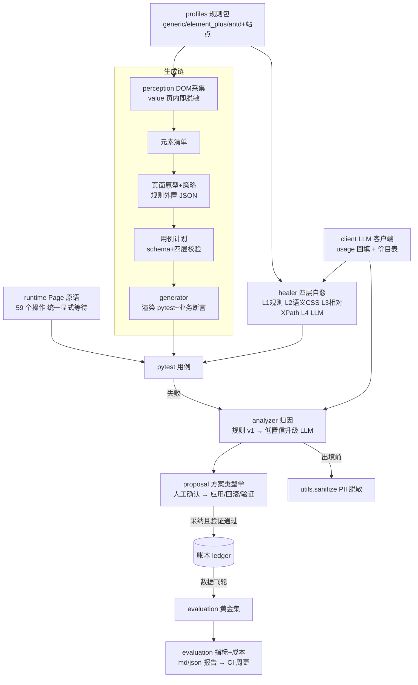

# ai_kit

## 30 秒开场

**是什么**：可移植的 Web UI 测试 AI 工具箱 —— 定位器自愈、失败归因、用例生成、离线评测。
依赖只有 `stdlib + selenium + requests`（白名单由测试强制，见"规模与测试哲学"），
Python `>=3.9`，版本 `0.1.0`。默认 0 成本跑规则层，加 `--llm` 才调大模型，每次调用记账。

**不是什么**：
- 不是接入你项目的私有库 —— 包内不 import 被测项目的 `pages/config/common`（守门测试点名检查）；
- 不是"什么都交给 LLM"的 agent 框架 —— 规则先行，LLM 只在规则低置信处补位，且出境前脱敏；
- 不是只会晒 demo 的生成器 —— 三套件都有黄金集实测指标，报告进 git 历史当趋势看板。

## 它解决什么

| 测试现场的老问题 | ai_kit 的做法 |
| --- | --- |
| 定位器一改就崩，靠人肉 F12 猜 | `healer` 四层自愈：L1 规则映射 → L2 多语义 CSS → L3 相对 XPath → L4 LLM 兜底；黄金集实测 top-1 87.5% / top-3 100%（n=24） |
| 挂了说不清是谁的锅 | `analyzer` 六分类归因（5 类规则可判 + 未知兜底），实测严格 96.7% / 含容错 100%（n=30）；`proposal` 把结论投影成 4 路 blame 与修复方案 |
| 用例一条条手写 | `perception` 采集 DOM → 元素清单 → 页面原型 → 策略 → 用例计划 → 渲染 pytest；`generator` 两步法补业务断言 |
| "AI 生成得好不好"没有度量 | `evaluation` 黄金集 + 指标纯函数 + 成本台账，`run_eval` 一条命令出 md/json 报告，CI 周更提交回仓库 |

## 架构



## 六条链路

### 1. 定位器自愈（healer）

定位失败后按四层递进产候选：L1 规则映射（profiles 外置 JSON，Element Plus/antd 的
wrapper、弹窗结构知识）、L2 多语义 CSS（class/文本/role 组合打分）、L3 相对 XPath
（锚点元素邻接）、L4 LLM 兜底（最多 3 段可见容器 outerHTML，各截断 4000 字符）。
候选由纯函数 `rank_candidates` 排序，命中结果落缓存，同一失效定位器不再重复花 token。
**关键决策**：LLM 是最后一层不是第一层 —— 离线模式 L4 恒为 0 候选，成本上限被结构锁死。

### 2. 失败归因（analyzer）

Phase 1 用 7 组正则规则判六类（定位器/等待/语法导入/环境/产品缺陷/未知），
置信 = 0.7 + 0.1×命中条数；置信 <0.8 或判入"未知"才升级 Phase 2 LLM（traceback 末
2000 + log 末 1000 字符，可附 1 张截图多模态），LLM 挂了降级回规则结果。
规则表/关键词表改动就 +1 版本号，评测报告记 `rules.v1`，回归时说得清基线是谁判的。
**关键决策**：容错口径 `acceptable_categories` 由人在黄金集里写、不由规则自报 ——
否则规则自己给自己放宽，准确率就不算数了。

### 3. 人工确认与应用（proposal）

归因结论投影成 blame 四路（测试代码/环境/产品/未知）+ 方案类型学，产出结构化确认报告
（schema 校验过的 JSON，不是散文）。人 accept 之前六道防护：clean 工作区检查、diff
可 apply 预检、备份、应用、pytest 验证、失败自动回滚。采纳且验证通过的补丁进账本。
**关键决策**：AI 只能"建议"，落盘必须过人手；验证不通过的回滚是流程的一部分而非异常。

### 4. 用例生成（perception + generator）

页面内 JS 采集可交互元素 → 元素清单（每条带多策略定位优先级）→ 页面原型分类 →
策略模板库（JSON 规则外置）→ 用例计划（结构化动作，四层校验：compile/schema/语义/
业务）→ 渲染 pytest 代码；`generator` 两步法在操作序列之上补业务断言。运行时统一走
`runtime.Page` 的 59 个操作，失败进"运行时统一失败处理流程"。
**关键决策**：中间产物是可校验的结构化计划而不是直接生成代码 —— LLM 输出先落 JSON
schema 这一关，才允许变代码。

### 5. 评测与成本（evaluation）

黄金集手写 analyzer 30 + healer 24 + generator 2 条（统一 schema，规模底线有硬断言，
CLI 样本不够直接退出码 1），指标全是纯函数（top-k / 分层占比 / ECE / 可靠性表 /
编译通过率 / 重复率）。成本从响应 `usage` 回填，按 model 查价目表换算元。
`run_eval` 一条命令出三套件合并报告；CI 每周一跑完把报告 commit 回仓库，git 历史
就是指标趋势看板。账本里被采纳的修复反哺黄金集（数据飞轮），评测集随使用增长。
**关键决策**：没跑的就是没跑 —— 骨架模式在报告里明写"不代表真实生成质量"，
缺配置的成本记 n/a，不编数字。

### 6. 数据安全（utils.sanitize）

三条 LLM 出境链（healer L4 DOM / analyzer 文本 / analyzer 截图）写了明文清单，
前两条出境前过 `sanitize`：抹 value 属性、textarea 内容、"字段名+值"的姓名/病历号
（含跨标签结构）、PII 提示元素内文、手机号、身份证；幂等、纯 stdlib、保留 DOM 骨架。
**关键决策**：脱敏目标是"值不出境"而不是"页面不可读" —— 按钮文案、class 刻意保留，
全抹掉等于把自愈能力废掉。

## 评测实测数字

2026-10-28 本机黄金集全量实测（离线模式，0 成本，`python -m ai_kit.evaluation.run_eval`）：

| 套件 | 样本 n | 主指标 | 实测 | 诚实标注 |
| --- | --- | --- | --- | --- |
| healer | 24 | top-1 / top-3 命中 | **87.5% / 100.0%** | L4 离线恒 0 候选，是口径限制不是退化；分层 L1 25.0% / L2 66.7% / L3 8.3% |
| analyzer | 30 | 严格 / 含容错准确 | **96.7% / 100.0%** | 平均置信 0.803 − 准确 0.967 = **-0.163 欠自信**，ECE(5箱) 0.163；唯一严格错例：定位器被判成等待（Stale 词面先命中） |
| analyzer blame | 30 | 分类一致率 | 96.7% → 容错后 100% | 分布 test_code 17 / product 6 / environment 5 / unknown 2 |
| generator | **2** | py_compile / 覆盖率 | 100% / 8.6% | ⚠ **n=2 骨架模式，只证明管道通，不证明生成质量**；覆盖率低是分母（业务断言）未喂 LLM 所致 |
| 真实 LLM 冒烟 | 1+1 | 三条断言 | **通过** | 真调到 / usage 采到 / 价目表认识型号；总成本 ≈0.0031 元（qwen-plus），n=1 只证通路 |

<details>
<summary>真实 LLM 冒烟报告原文（2026-10-27 真 key 实跑，未改动）</summary>

```markdown
# AI 评测报告

- 生成时间: 2026-10-27 17:01:50
- 模式: 含真实 LLM (--llm)
- 浏览器可用: True

## 2. 归因评测 (分类准确率 + 过度/欠自信 + ECE)
- 样本: 1 条 | 规则版本 rules.v1
- **准确率**: 严格 100.0% | 含容错 100.0% (宽容 0 条)
- **Phase-2 LLM**: 准确率 100.0% | 含容错 100.0% | 平均置信 0.95 | ECE 0.05 | 校准 -0.050 (欠自信)
- 每次成本 (LLM): 0.000622 元/次

## 3. 生成评测 (py_compile率 / 覆盖率 / 重复率)
- 模式: llm | 样本: 1
- **py_compile 通过率**: 100.0%
- **覆盖率(召回)**: 100.0%
- **重复率**: 方法名碰撞 0.0% | 步骤近重复 0.0%
- 每次成本: 0.002441 元/次 | 每页成本: 0.002441 元/页 (共 1 页)

## 4. 成本汇总 (token × 价目表)

| 套件 | 样本 n | LLM 调用 | 输入 tokens | 输出 tokens | 总成本(元) | 单次(元) | 每页(元) |
|------|--------|---------|------------|------------|-----------|---------|---------|
| analyzer | 1 | 1 | 378 | 160 | 0.000622 | 0.000622 | n/a |
| generator | 1 | 1 | 576 | 990 | 0.002441 | 0.002441 | 0.002441 |

## 5. `--llm` 冒烟 (usage 采集 + 成本换算)

| 套件 | LLM 调用 | 输入 tokens | 输出 tokens | 单次(元) | 价目表 | 结论 |
|------|---------|------------|------------|---------|--------|------|
| analyzer | 1 | 378 | 160 | 0.000622 | 命中 | ✓ |
| generator | 1 | 576 | 990 | 0.002441 | 命中 | ✓ |

- 结论: **通过** (三条都要过: 真的调到了 / usage 采到了 / 价目表认识这个型号)
```

口径说明：`--smoke` 下 analyzer **强制走 Phase 2**（`eval_analyzer._eval_mode(force_llm=True)`），
否则黄金集第一条被规则 0.9 高分命中、生产升级门槛挡住，`llm_calls` 恒为 0，冒烟会把
"通路是好的"误报成"通路坏了"；LLM 挂了仍降级回规则。CI（`.github/workflows/eval.yml`）
的 `workflow_dispatch` 可手动触发，"LLM 冒烟"步骤 `if: env.QIANWEN_API_KEY != ''` ——
secret 没配就整步 skip，不算失败。

</details>

## 三条命令

```bash
pip install -e ".[test]" && python -m pytest -q          # 全量回归（Windows 先设 PYTHONUTF8=1）
python -m ai_kit.evaluation.golden                        # 黄金集规模体检，样本不够退出码 1
python -m ai_kit.evaluation.run_eval                      # 离线评测出报告；加 --llm --smoke 才花钱
```

真实归因/自愈需要 provider 配置：`AI_ACTIVE_PROVIDER` + 对应 `*_API_KEY`（见 `.env.example`），
密钥只走环境变量、不落盘、不进提示词。

## 规模与测试哲学

全量回归原文（2026-10-28 本机）：

```
1096 passed, 2 warnings in 104.49s (0:01:44)
```

测试不是覆盖率装饰，架构决策靠命名成句的守门测试看住。点名三个：

| 守门测试 | 守住的决定 |
| --- | --- |
| `test_package_import.py::test_top_level_package_stays_lazy` | PEP 562 惰性导出：`import ai_kit` 不拉起 selenium/子模块，`__all__` 与 `dir()` 一致，装了包但没装 selenium 的进程也能 import |
| `test_package_import.py::test_guard_detects_a_smuggled_host_project_import` | 守门自检：往源码树塞一条 import 宿主项目的语句，依赖白名单扫描必须抓到 —— 证明守门器本身不是摆设 |
| `test_golden.py::test_the_analyzer_golden_set_meets_its_floor`（healer 同） | 黄金集规模底线：analyzer ≥30 / healer ≥24，样本缩水直接红，指标分母不保真 |

其余惯例：指标全是纯函数（给 dict 出数字，不碰 IO）；LLM 一律 mock 或显式 `--llm`，
CI 默认路径 0 成本；报告数字与代码口径冲突时以重跑为准。

## 数据安全

这个包会把页面内容送到外部大模型，所以出境点写了明文清单，代码改到这里请同步本表。

### 出境点清单

| 出境点 | 送出去的内容 | 处理 |
| --- | --- | --- |
| `healer` L4 | 最多 3 段可见容器 `outerHTML`（每段截断 4000 字符） | **已脱敏**：拼提示词前过 `ai_kit.utils.sanitize` |
| `analyzer` 文本 | traceback 末 2000 字符 + log 末 1000 字符 | **已脱敏**：同一函数，出境前过 `sanitize` |
| `analyzer` 多模态 | 失败截图 base64（1 张） | **不做文本脱敏**：像素里的身份证/病历号无法用正则抹。要合规就裁切，或者不传 `screenshot_base64` |
| 评测黄金集 | `golden/*.json` + `golden/fixtures/*.html` | 全部手写合成页，不含真实业务数据；`--llm` 跑评测时送出去的也是这些合成样本 |
| `perception` 采集 / 用例生成 | 元素清单（`text/attrs/constraints/html`） | `value` 在页面内 JS 里就换成 `[REDACTED]`（`collector.py`）；元素可见文本**未过** `sanitize`，见下方边界 |

### 脱敏做什么

`ai_kit.utils.sanitize`（纯 stdlib 正则、无状态、幂等）会抹掉：

- HTML 的 `value` 属性、`<textarea>` 内容（`option/li` 的 value 是选项标识，保留）
- `class/id/name/data-*` 带 `patient-name`、`idCard`、`phone`、`mrn` 之类提示的元素内文
- `姓名：X`、`<label>姓名</label>…X`、`病历号：X` 这类"字段名 + 值"里的值（含值在下一个标签的跨标签结构）
- 手机号（含 `138-1234-5678` 分隔写法）、身份证（18 位含 X / 老式 15 位）

刻意保留：标签名、属性名、class、可见按钮文案（`删除患者` 这种）。LLM 靠这些推选择器，
全抹掉等于把自愈能力废掉 —— 脱敏的目标是"值不出境"，不是"页面不可读"。

### 边界（不要当成万能合规方案）

- 不认识**没有字段名提示的裸文本**：表格里孤零零一个"张三"，正则分不出它是姓名还是科室名。
  这类靠 `value` / `class` / 字段名前缀覆盖，漏了就漏了，宁可漏也不乱猜；
- **`perception` / `generator` 的链路只做了 value 脱敏**：元素清单里的可见文本（`text`）没接 `sanitize`，
  医疗类页面表格里的姓名仍可能随用例生成出境。接法同 L4（拼提示词前包一层），但会改变生成质量，
  需要先在黄金集上对比，所以没有顺手改；
- 不处理**图片**：截图见上表；
- 不做**去标识化关联**：抹掉的是值本身，不是把它换成稳定假名，所以"同一患者"在两次调用间不可追踪。

要接新的出境点，先加 `sanitize(...)`，再在 `tests/test_utils_sanitize.py` 里补一条"合成数据 → 断言零残留"。

## ROADMAP（未做，各带验收口径）

1. **`perception`/`generator` 可见文本接 `sanitize`** —— 会改变生成质量，先在黄金集上跑对比再合；
2. **`utils.dom_diff`** —— 目前只有 docstring 声明、无实现，与 L4 的 DOM 差异定位是同一需求；
3. **评测指标 v2 六项**（跨页泛化 / 自愈稳定性等）—— 报告里现在标 `—`，没跑就是没跑；
4. **CI 真实触发验证 + 全量 `--llm` 评测** —— 本仓库当前尚未配 git remote，push 到 GitHub 后
   从 Actions 页 `Run workflow` 实触发一次冒烟；全量 `--llm`（30+24 条真调）花钱多，没顺手跑。

<!-- CI 徽章: 推到 GitHub 后把 <owner>/<repo> 换成真实地址即生效

-->
