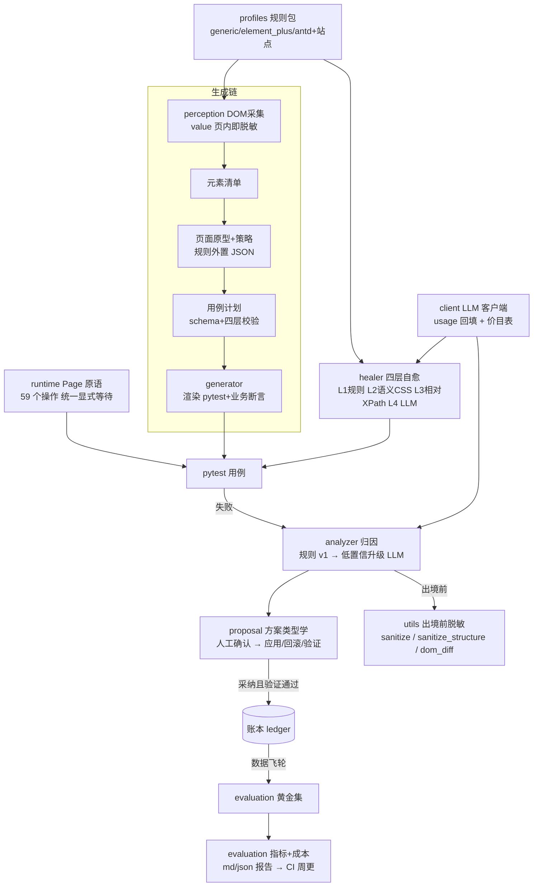

# ai_kit

仓库：<https://gitee.com/twinkleqwq/ai_kit>　|　CI 配置 `.github/workflows/eval.yml` 为 GitHub Actions 语法，Gitee 不执行（见 ROADMAP 第 2 条）

## 30 秒开场

**是什么**：可移植的 Web UI 测试 AI 工具箱 —— 定位器自愈、失败归因、用例生成、离线评测。
依赖只有 `stdlib + selenium + requests`（白名单由测试强制，见"规模与测试哲学"），
Python `>=3.9`，版本 `0.1.0`。默认 0 成本跑规则层，加 `--llm` 才调大模型，每次调用记账。

**不是什么**：
- 不是接入你项目的私有库 —— 包内不 import 被测项目的 `pages/config/common`（守门测试点名检查）；
- 不是"什么都交给 LLM"的 agent 框架 —— 规则先行，LLM 只在规则低置信处补位，且出境前脱敏；
- 不是只会晒 demo 的生成器 —— 三套件都有黄金集实测指标，报告进 git 历史当趋势看板。

**只适用什么**：`perception` 的生成链只认五类后台形态 —— 登录页 / 列表增删改查 / 表单填写 /
只读详情 / 数据看板。页面属于这五类，用例才可能有意义；其它形态（门户首页、电商详情、
对话式界面、文档站等）请别用：轻则分类落 `unknown`（派生不出用例），重则被兜底规则误判 ——
实测一个 AI 聊天页被判成"只读详情"（置信度 0.65，高过 LLM 复核阈值，属静默误判），
于是为 24 个元素里的 23 个侧边栏按钮派生了 20 条"按钮权限校验"用例，全部无意义。
`healer` / `analyzer` / `evaluation` 不受此限，它们只看定位器、日志和样本。

## 它解决什么

| 测试现场的老问题 | ai_kit 的做法 |
| --- | --- |
| 定位器一改就崩，靠人肉 F12 猜 | `healer` 四层自愈：L1 规则映射 → L2 多语义 CSS → L3 相对 XPath → L4 LLM 兜底；黄金集实测 top-1 91.7% / top-3 100%（n=24，含真实 LLM） |
| 挂了说不清是谁的锅 | `analyzer` 六分类归因（5 类规则可判 + 未知兜底），实测严格 96.7% / 含容错 100%（n=30）；`proposal` 把结论投影成 4 路 blame 与修复方案 |
| 用例一条条手写 | `perception` 采集 DOM → 元素清单 → 页面原型 → 策略 → 用例计划 → 渲染 pytest；`generator` 两步法补业务断言 |
| "AI 生成得好不好"没有度量 | `evaluation` 黄金集 + 指标纯函数 + 成本台账，`run_eval` 一条命令出 md/json 报告，接上 CI 即可周更提交回仓库 |

## 架构



## 六条链路

### 1. 定位器自愈（healer）

定位失败后按四层递进产候选：L1 规则映射（profiles 外置 JSON，Element Plus/antd 的
wrapper、弹窗结构知识）、L2 多语义 CSS（class/文本/role 组合打分）、L3 相对 XPath
（锚点元素邻接）、L4 LLM 兜底（最多 3 段可见容器 outerHTML，各截断 4000 字符）。
候选由纯函数 `rank_candidates` 排序，命中结果落缓存，同一失效定位器不再重复花 token。
**关键决策**：LLM 是最后一层不是第一层 —— 离线模式 L4 恒为 0 候选，成本上限被结构锁死。

### 2. 失败归因（analyzer）

Phase 1 用 7 组正则规则判六类（定位器/等待/语法导入/环境/产品缺陷/未知），
置信 = 0.7 + 0.1×命中条数；置信 <0.8 或判入"未知"才升级 Phase 2 LLM（traceback 末
2000 + log 末 1000 字符，可附 1 张截图多模态），LLM 挂了降级回规则结果。
规则表/关键词表改动就 +1 版本号，评测报告记 `rules.v1`，回归时说得清基线是谁判的。
**关键决策**：容错口径 `acceptable_categories` 由人在黄金集里写、不由规则自报 ——
否则规则自己给自己放宽，准确率就不算数了。

### 3. 人工确认与应用（proposal）

归因结论投影成 blame 四路（测试代码/环境/产品/未知）+ 方案类型学，产出结构化确认报告
（schema 校验过的 JSON，不是散文）。人 accept 之前六道防护：clean 工作区检查、diff
可 apply 预检、备份、应用、pytest 验证、失败自动回滚。采纳且验证通过的补丁进账本。
**关键决策**：AI 只能"建议"，落盘必须过人手；验证不通过的回滚是流程的一部分而非异常。

### 4. 用例生成（perception + generator）

页面内 JS 采集可交互元素 → 元素清单（每条带多策略定位优先级）→ 页面原型分类 →
策略模板库（JSON 规则外置）→ 用例计划（结构化动作，四层校验：compile/schema/语义/
业务）→ 渲染 pytest 代码；`generator` 两步法在操作序列之上补业务断言。运行时统一走
`runtime.Page` 的 59 个操作，失败进"运行时统一失败处理流程"。
**关键决策**：中间产物是可校验的结构化计划而不是直接生成代码 —— LLM 输出先落 JSON
schema 这一关，才允许变代码。

### 5. 评测与成本（evaluation）

黄金集 analyzer 30 + healer 24 + generator 10（手写 2 + 真页面采集脱敏冻结 8，
统一 schema，规模底线有硬断言，CLI 样本不够直接退出码 1），指标全是纯函数（top-k /
分层占比 / ECE / 可靠性表 / 编译通过率 / 重复率 / 感知链 eid 解析率与可执行率 /
自愈稳定性（重复一致·命中冗余·排名稳固）/ 跨页泛化（短板页覆盖率·原型分桶））。
成本从响应 `usage` 回填，按 model 查价目表换算元。
`run_eval` 一条命令出三套件合并报告；CI 设计每周一跑完把报告 commit 回仓库，git 历史
就是指标趋势看板 —— 仓库现托管 Gitee，该 workflow 不会自动执行，当前靠本地手动跑。
账本里被采纳的修复反哺黄金集（数据飞轮），评测集随使用增长。
除三套件外还有**套件4 方案层人决策**（`eval_proposal`）：直接读本地 `decisions.jsonl` 账本
算接受率（accept/(accept+reject)，defer 不进分母）与验证成功率（采纳且重跑通过/采纳数），
按方案类型分列 —— 类型不在账本七个键里，靠 join `report.json` 补，join 不上就落 unknown
桶，绝不从 note 猜。飞轮 docstring 早写了“负样本是将来做方案层评测的反面清单”，这一套件是它兑现的第一步。
**关键决策**：没跑的就是没跑 —— 骨架模式在报告里明写“不代表真实生成质量”，
缺配置的成本记 n/a，没账本直接 SKIPPED，不编数字。

### 6. 数据安全（utils.sanitize / sanitize_structure / dom_diff）

七条 LLM 出境链（healer L4 DOM / analyzer 文本 / generator 用例生成 / perception 清单摘要 /
perception 原型确认 / proposal 归因与方案 / DOM 差异文本），除截图外全部在"拼完提示词、发出前"
过一遍脱敏，清单见下方[出境点清单](#出境点清单)。

三个工具分工：`sanitize` 抹 value 属性、textarea 内容、"字段名+值"的姓名/病历号（含跨标签结构）、
PII 提示元素内文、手机号、身份证，幂等、纯 stdlib、保留 DOM 骨架；`sanitize_structure` 把送模型的
嵌套清单（`slim_inventory` / `slim_page_structure`）逐字符串过筛 —— 不对整段 JSON 跑正则，因为
JSON 里的值没有标签和字段名提示，正则只会误伤 eid 与行数；`dom_diff` 的产物本来就是给报告和
提示词的，默认 `redact=True`。

**关键决策**：脱敏目标是"值不出境"而不是"页面不可读" —— 按钮文案、class 刻意保留，
全抹掉等于把自愈能力废掉；表格样例行是唯一例外，整格抹成 `[REDACTED]`（一个没有字段名提示的
孤立"张三"判不出来，那就别猜）。

接线的质量代价已经量过：黄金集 8 页在冻结时就脱敏过，接上 `sanitize_structure` 之后 `--llm` 的
prompt **逐字节不变**（`tests/test_prompts.py` 里有一条守门测试钉住这个结论），所以召回 31.1% /
元素覆盖率 23.4% 与接线前一致。

## 评测实测数字

2026-10-28 本机黄金集全量实测（**含真实 LLM**，单次成本 0.0287 元，`python -m ai_kit.evaluation.run_eval --llm`）：

| 套件 | 样本 n | 主指标 | 实测 | 诚实标注 |
| --- | --- | --- | --- | --- |
| healer | 24 | top-1 / top-3 命中 | **91.7% / 100.0%** | 两次全量 `--llm` 分别 95.8% / 91.7%，top-3 两次都是 100% —— 差的 1 条 case 来自 L4 的 LLM 非确定性，不是回归。分层 L1 25.0% / L2 37.5% / L3 0.0% / **L4 37.5%**：L4 真跑后贡献了 9 条 top-1，离线时它恒 0 候选 |
| analyzer | 30 | 规则严格 / 含容错 | **96.7% / 100.0%** | 平均置信 0.803 − 准确 0.967 = **-0.163 欠自信**，ECE(5箱) 0.163；唯一严格错例：定位器被判成等待（Stale 词面先命中） |
| analyzer Phase-2 LLM | 30 条中 15 条升级 | 准确率 / 含容错 | **93.3% / 96.7%** | **LLM 没有比规则更准**（93.3% vs 96.7%），它的价值在置信度校准（gap +0.008 vs 规则 -0.163）。首轮实测只有 86.7%，查出是 LLM 把 prompt 里的编号“5”当分类回、`normalize_category` 原样透传；修复后 93.3%（详 `tests/test_analyzer.py`） |
| analyzer blame | 30 | 分类一致率 | 96.7% → 容错后 100% | 分布 test_code 17 / product 6 / environment 5 / unknown 2 |
| generator | **10** (手写 2 + 采集冻结 8) | py_compile / 覆盖率 | **100% / 31.1%** | 真实 `--llm`，不再是骨架模式。覆盖率是个**口径偏低的指标**：`_plan_to_text` 只拼 class/method/title/steps/expected，steps 是 `{action, eid}` 结构化动作，页面中文文案本来就不在文本里 —— 骨架 29.2% → 真 LLM 31.1%，只差 1.9pp，说明瓶颈不在“有没喂 LLM”。元素覆盖率是另一把尺子，见下一行 |
| generator 元素覆盖率 | **8** 页 / 282 个交互元素 | 被 ≥1 条用例点到的交互元素占比 | **23.4% (66/282)** | 分母是 `inventory.by_eid`（表格/弹窗/图表走 `lookup` 不在内，引用它们也不进分子），跨页分子分母各自相加而非对每页 rate 取均值。低是**真实覆盖面**：感知链不走 LLM，确定性规划器只走核心 CRUD 路径（`G_operators` 21 个元素只点到 2 个），所以这一行与 `--llm` 无关。与召回 31.1% 不是同一把尺子，不互相替代 |
| generator 感知链 | **8** 条采集冻结样本 | eid 解析率 / 可执行率 | **100.0% (260/260) / 92.3% (108/117)** | 确定性规划器无幻觉，解析率预期接近 100%，真能打破它的是 --llm 引用幻觉（本期未接）；可执行率里 9 条 needs_review 全部同一原因：`set_network` 需 CDP 断网、渲染器诚实拒收；活页面层离线跳过 (live_skipped) 不影响这两项 |
| 方案层人决策 proposal | **1** | 接受率 / 验证成功率 | 0.0% / n/a | ⚠ **n=1 仅一条 reject，样本量不足以谈比率**；验证成功率 n/a 是因 0 条被采纳（非 0%）；类型 join 认出 0 / unknown 1（本仓库未留档 report.json，宁可一桶 unknown 也不从 note 猜类型） |
| 全量 `--llm` 成本 | 64 | — | **0.0287 元/次** | analyzer 15 次 0.0078 元 + generator 10 次 0.0209 元（qwen-plus，价目表快照输入 0.0008/输出 0.002 元每 1k）；最贵的是一次生成 8708 输出 tokens |
| 真实 LLM 冒烟 | 1+1 | 三条断言 | **通过** | 真调到 / usage 采到 / 价目表认识型号；总成本 ≈0.0029 元（analyzer 0.000552 + generator 0.002307），n=1 只证通路 |

**指标 v2（2026-10-28 离线实测，0 成本，`run_eval` 默认路径）**：

| 指标 | 实测 | 口径与诚实标注 |
| --- | --- | --- |
| 自愈稳定性 · 重复调用一致 | **100.0%（24/24）** | 同夹具同入参连跑两次，候选序列（by + locator + 顺序）逐字节相等。规则层本来就确定，这条的价值是**回归护栏**：一旦跌破 100%，说明有隐藏状态泄漏；注入 LLM 的条目不重复跑（否则一次评测翻倍花钱），不进分母 |
| 自愈稳定性 · 命中冗余 | **66.7%（16/24）** | 有 ≥2 个候选落到同一期望元素的 case 占比 —— 排头那个失效时还有下一手。剩下 8 条只有单一命中，其中 5 条点名在 `fragile_cases`（`H5_select_wrapper` / `H14` / `H16` / `H17` / `H18`） |
| 自愈稳定性 · 排名稳固 | **87.5%（21/24）** | top1 命中 / top3 命中。差的 3 条是“命中了但排在二三位”，换页面版本就可能掉出 top1 |
| 跨页泛化 · 短板页覆盖 | **9.5%**（最低页） / 中位 29.6% / 最高 100% | 8 页 282 个交互元素。主指标取**最差页**而不是均值 —— 7 页好、1 页空，均值照样高，但上线就瞎在那页；覆盖率低于一半的页 7 页 |
| 跨页泛化 · 空页 | **0 页** | 没有任何一页“一条用例都派生不出来”（这类页比覆盖率低更严重，会单独点名） |
| 跨页泛化 · 按原型 | form 5 页 26.4% / login 1 页 100.0% / **unknown 2 页 19.3%** | 2 页（`G_board` / `G_board_add`）5 条规则全不中：无表格、`charts=0`、按钮 62/65 个不满足 dashboard 的“稀疏”条件 —— 这是**分类器覆盖缺口**，不是覆盖率问题，记在这里不藏 |

<details>
<summary>真实 LLM 冒烟报告原文（2026-10-27 真 key 实跑，未改动）</summary>

```markdown
# AI 评测报告

- 生成时间: 2026-10-27 17:01:50
- 模式: 含真实 LLM (--llm)
- 浏览器可用: True

## 2. 归因评测 (分类准确率 + 过度/欠自信 + ECE)
- 样本: 1 条 | 规则版本 rules.v1
- **准确率**: 严格 100.0% | 含容错 100.0% (宽容 0 条)
- **Phase-2 LLM**: 准确率 100.0% | 含容错 100.0% | 平均置信 0.95 | ECE 0.05 | 校准 -0.050 (欠自信)
- 每次成本 (LLM): 0.000622 元/次

## 3. 生成评测 (py_compile率 / 覆盖率 / 重复率)
- 模式: llm | 样本: 1
- **py_compile 通过率**: 100.0%
- **覆盖率(召回)**: 100.0%
- **重复率**: 方法名碰撞 0.0% | 步骤近重复 0.0%
- 每次成本: 0.002441 元/次 | 每页成本: 0.002441 元/页 (共 1 页)

## 4. 成本汇总 (token × 价目表)

| 套件 | 样本 n | LLM 调用 | 输入 tokens | 输出 tokens | 总成本(元) | 单次(元) | 每页(元) |
|------|--------|---------|------------|------------|-----------|---------|---------|
| analyzer | 1 | 1 | 378 | 160 | 0.000622 | 0.000622 | n/a |
| generator | 1 | 1 | 576 | 990 | 0.002441 | 0.002441 | 0.002441 |

## 5. `--llm` 冒烟 (usage 采集 + 成本换算)

| 套件 | LLM 调用 | 输入 tokens | 输出 tokens | 单次(元) | 价目表 | 结论 |
|------|---------|------------|------------|---------|--------|------|
| analyzer | 1 | 378 | 160 | 0.000622 | 命中 | ✓ |
| generator | 1 | 576 | 990 | 0.002441 | 命中 | ✓ |

- 结论: **通过** (三条都要过: 真的调到了 / usage 采到了 / 价目表认识这个型号)
```

口径说明：`--smoke` 下 analyzer **强制走 Phase 2**（`eval_analyzer._eval_mode(force_llm=True)`），
否则黄金集第一条被规则 0.9 高分命中、生产升级门槛挡住，`llm_calls` 恒为 0，冒烟会把
"通路是好的"误报成"通路坏了"；LLM 挂了仍降级回规则。CI 配置（`.github/workflows/eval.yml`）
是 GitHub Actions 语法：`workflow_dispatch` 手动触发、冒烟步骤 `if: env.QIANWEN_API_KEY != ''`
（secret 没配就整步 skip 不算失败）。仓库在 Gitee，Actions ≠ Gitee Go，这条流水线不会自动跑；
等价本地命令：`python -m ai_kit.evaluation.run_eval --llm --smoke`。

</details>

## 从零跑起来

前置只有两样：**Python ≥3.9**（本机 3.12.0 实测）和一个浏览器（Edge 或 Chrome，自愈评测要用）。
不需要数据库、不需要 Docker；不配 key 也能跑离线评测和全量测试。

**1. 拿代码，建虚拟环境**

```powershell
git clone https://gitee.com/twinkleqwq/ai_kit.git
cd ai_kit
python -m venv .venv
.venv\Scripts\Activate.ps1
```

```bash
# macOS / Linux
python3 -m venv .venv
source .venv/bin/activate
```

> PowerShell 提示 `无法加载文件 ...Activate.ps1，因为在此系统上禁止运行脚本`：
> 先执行 `Set-ExecutionPolicy -Scope Process -ExecutionPolicy Bypass`（只对当前窗口生效），再激活。

**2. 装依赖**

```powershell
pip install -e ".[test]"
```

`-e` 是可编辑安装（改代码立刻生效，不用重装），`[test]` 额外装 `pytest` 与 `allure-pytest`；
只要运行不要测试就 `pip install -e .`。第三方依赖只有 `selenium` 和 `requests` 两家。

**3. 配 LLM（可选）** —— 只有真跑 `--llm`（花钱的那条）才需要，离线评测、黄金集体检、全量测试都不需要。

```powershell
Copy-Item .env.example .env
```

把 `QIANWEN_API_KEY=` 后面填上自己的 key；换别家改 `AI_ACTIVE_PROVIDER`（deepseek / doubao / ollama，
ollama 是本地服务、不用 key）。`.env` 已被 `.gitignore` 忽略，不会进仓库；`ai_kit.config` 启动时
自动加载它（查找顺序 `AI_KIT_ENV_FILE` → 当前目录 `.env` → 仓库根 `.env`，不覆盖已存在的环境变量），
**不用手动 export**。

自检（打印配置，key 只显掩码 `sk-ab****yz`，不联网）：

```powershell
python -m ai_kit.config          # provider / model / 单价 / .env 有没有被找到
python -m ai_kit.config --ping   # 真调一次验连通性，消耗极少 token
```

**4. 验证装对了**

```powershell
python -m pytest -q                    # 全量回归，当前 1145 passed
python -m ai_kit.evaluation.golden     # 黄金集体检，期望三行 OK + schema 0 个问题
python -m ai_kit.evaluation.run_eval   # 离线评测，约 12 秒，0 成本
```

黄金集体检的预期输出：

```
analyzer   n=30  底线 30  OK
healer     n=24  底线 20  OK
generator  n=10  底线 8   OK

schema: 0 个问题
```

`run_eval` 把 `ai_evaluation_report.md` / `.json` 写到**当前目录**（已被 `.gitignore` 忽略），
离线模式开头应是：

```
- 模式: 离线规则/骨架 (0 成本, 默认)
- 浏览器可用: True
```

`浏览器可用: False` 不是装错：本机 Edge/Chrome 都没拉起来，自愈套件会标 `SKIPPED` 而不是失败，
装上任一浏览器即可；Selenium 4.10+ 自带 selenium-manager 自动匹配驱动，**不用手装 chromedriver**。

**常见问题**

| 现象 | 原因与处理 |
| --- | --- |
| 控制台中文乱码，或报 `UnicodeEncodeError: 'gbk' codec can't encode` | 终端与 Python 两侧编码不一致。Windows 上先 `chcp 65001` 切 UTF-8 代码页，再设 `$env:PYTHONUTF8=1`；或直接用 Windows Terminal / PowerShell 7（默认 UTF-8） |
| `python` 不是内部或外部命令，或敲 `python` 弹出应用商店 | 用 `py -3`（官方启动器，一般随安装就有）；虚拟环境激活后 `python` 一定指向 `.venv\Scripts\python.exe` |
| `pip install -e ".[test]"` 报 extras 不认识 | 必须在仓库根（有 `pyproject.toml`），PowerShell 里引号不能省 |
| `No module named ai_kit` | 没装或没激活虚拟环境，回第 1、2 步 |
| healer 显示 SKIPPED | 没起得来浏览器，见上一条；不影响 analyzer / generator |

## 三条命令

```bash
python -m pytest -q                                       # 全量回归（中文乱码就加 -X utf8）
python -m ai_kit.evaluation.golden                        # 黄金集规模体检，样本不够退出码 1
python -m ai_kit.evaluation.run_eval                      # 离线评测出报告；加 --llm 全量约 0.029 元
```

装依赖见上一节第 2 步。PowerShell 5 不支持 `&&`，别把两条命令拼成一行（用 `;` 或直接分两行）。

真实归因/自愈需要 provider 配置：`AI_ACTIVE_PROVIDER` + 对应 `*_API_KEY`（见 `.env.example`），
密钥只走环境变量、不落盘、不进提示词。

## 规模与测试哲学

全量回归原文（2026-10-28 本机）：

```
1145 passed, 2 warnings in 136.13s (0:02:16)
```

测试不是覆盖率装饰，架构决策靠命名成句的守门测试看住。点名三个：

| 守门测试 | 守住的决定 |
| --- | --- |
| `test_package_import.py::test_top_level_package_stays_lazy` | PEP 562 惰性导出：`import ai_kit` 不拉起 selenium/子模块，`__all__` 与 `dir()` 一致，装了包但没装 selenium 的进程也能 import |
| `test_package_import.py::test_guard_detects_a_smuggled_host_project_import` | 守门自检：往源码树塞一条 import 宿主项目的语句，依赖白名单扫描必须抓到 —— 证明守门器本身不是摆设 |
| `test_golden.py::test_the_analyzer_golden_set_meets_its_floor`（healer / generator 同） | 黄金集规模底线：analyzer ≥30 / healer ≥20 / generator ≥8（当前样本 30 / 24 / 10），样本缩水直接红，指标分母不保真 |

其余惯例：指标全是纯函数（给 dict 出数字，不碰 IO）；LLM 一律 mock 或显式 `--llm`，
CI 默认路径 0 成本；报告数字与代码口径冲突时以重跑为准。

## 数据安全

这个包会把页面内容送到外部大模型，所以出境点写了明文清单，代码改到这里请同步本表。

### 出境点清单

| 出境点 | 送出去的内容 | 处理 |
| --- | --- | --- |
| `healer` L4 | 最多 3 段可见容器 `outerHTML`（每段截断 4000 字符） | **已脱敏**：拼提示词前过 `ai_kit.utils.sanitize` |
| `analyzer` 文本 | traceback 末 2000 字符 + log 末 1000 字符 | **已脱敏**：同一函数，出境前过 `sanitize` |
| `generator` 用例生成 | `slim_page_structure`：元素的 eid/text/tag/role/name/container/risk、约束与选项、表格列名与样例行、弹窗文案、页面标题与 url | **已脱敏**：出口过 `sanitize_structure`；`sample_rows` 按“格子就是数据”整格抹除（保留行列形状，最多 2 行 20 列） |
| `perception` 清单摘要 | `slim_inventory`：eid/kind/type/name/container/risk/options/constraints + 标题/url/原型/信号 + 表格列名/行数/行内动作 + 弹窗按钮（不送 `text`/`html`/`attrs`） | **已脱敏**：出口过 `sanitize_structure` |
| `perception` 原型确认 | 页面标题 + 前 20 个元素摘要（eid/kind/name/container/risk/required） | **已脱敏**：`_confirm_prompt` 出口过 `sanitize` |
| `proposal` 归因 / 方案 | 用例标识 + traceback + 日志 + 页面快照 + 执行步骤；改目标文件与候选定位串 | **已脱敏**：两处 `_llm_user` 出口过 `sanitize`（定位串与文件名不碰） |
| `dom_diff` | 操作前后可见文本行 + 标签签名（tag/role/type/name，**不含 class**） | **默认脱敏**：`redact=True`，产物进报告与提示词；无变化时返回一句说明而不是空串 |
| `analyzer` 多模态 | 失败截图 base64（1 张） | **不做文本脱敏**：像素里的身份证/病历号无法用正则抹。要合规就裁切，或者不传 `screenshot_base64` |
| 评测黄金集 | `golden/*.json` + `golden/fixtures/*.html` | 手写合成页；`source=collected` 的 8 条是 collector 从真页面采集后**脱敏冻结**的清单（域名换合成/表格裸文本清零/html 丢弃/sanitize+scrub，落盘前零残留扫描命中即拒写），不含真实业务数据；`--llm` 跑评测时送出去的也是这些样本 |
| `perception` 采集 | 元素清单（`text/attrs/constraints/html`） | `value` 在页面内 JS 里就换成 `[REDACTED]`（`collector.py`）；元素可见文本和上述 `text` 字段一样，出境前由 `sanitize_structure` 兜一层，但 raw 清单本身仍带可见文本，落盘会存原文 |

### 脱敏做什么

`ai_kit.utils.sanitize`（纯 stdlib 正则、无状态、幂等）会抹掉：

- HTML 的 `value` 属性、`<textarea>` 内容（`option/li` 的 value 是选项标识，保留）
- `class/id/name/data-*` 带 `patient-name`、`idCard`、`phone`、`mrn` 之类提示的元素内文
- `姓名：X`、`<label>姓名</label>…X`、`病历号：X` 这类"字段名 + 值"里的值（含值在下一个标签的跨标签结构）
- 手机号（含 `138-1234-5678` 分隔写法）、身份证（18 位含 X / 老式 15 位）
- 送模型的清单摘要里每个字符串都过同一套规则（`sanitize_structure`），并且表格样例行**不靠猜**：
  整格抹成 `[REDACTED]`，行列形状保留 —— 模型仍能看出“这表几行几列、列名叫什么”

刻意保留：标签名、属性名、class、可见按钮文案（`删除患者` 这种）。LLM 靠这些推选择器，
全抹掉等于把自愈能力废掉 —— 脱敏的目标是"值不出境"，不是"页面不可读"。

### 边界（不要当成万能合规方案）

- 不认识**没有字段名提示的裸文本**：表格里孤零零一个“张三”，正则分不出它是姓名还是科室名。
  清单摘要走 `sanitize_structure` 也是对同一套规则，所以这类只靠 `value` / `class` / 字段名前缀覆盖，
  漏了就漏了，宁可漏也不乱猜；表格样例行是唯一例外 —— 那里按“格子就是数据”整格抹除，不猜；
- 只认**带 PII 提示的 class/id/name**：`<span class="col-3">张三</span>` 这类无名提示的字段照样漏；
- 不处理**图片**：截图见上表；
- 不做**去标识化关联**：抹掉的是值本身，不是把它换成稳定假名，所以“同一患者”在两次调用间不可追踪。

要接新的出境点，先加 `sanitize(...)` / `sanitize_structure(...)`，再在 `tests/test_utils_sanitize.py`
或 `tests/test_prompts.py` 里补一条“合成数据 → 断言零残留 + 结构保留”。

## ROADMAP（未做，各带验收口径）

1. **perception 真检出 P/R**（元素该采到的采到了几成 / 采到的里有几成是真的）—— 需要人工
   标注每页元素真值，采集一张页就要标一张，成本高；本期只上了解析率/可执行率这两个
   无需真值的链路率，**P/R 没做，不装做能做**；
2. **CI 真实触发验证** —— 仓库现托管 Gitee（`gitee.com/twinkleqwq/ai_kit`），
   `.github/workflows/eval.yml` 不会被 Gitee 执行；要自动周更需接 Gitee Go（或回 GitHub）。
   全量 `--llm` 已跑完（0.0287 元/次，数字见上表），CI 等价物就是本地手动跑 `run_eval --llm`。

已收口的三项（不再是 ROADMAP）：`perception`/`generator` 可见文本接 `sanitize`、`utils.dom_diff`
实现、指标 v2（跨页泛化 / 自愈稳定性）—— 结论与数字见上表与 [CHANGELOG.md](CHANGELOG.md)。

## 许可证

MIT © 2026 Twinkle-qwq，见 [LICENSE](LICENSE)。
